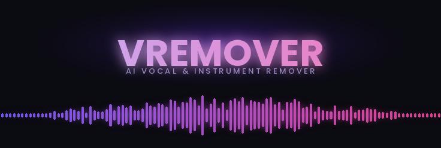

# 🎙️ VREMOVER

<p align="center">
  
</p>

<p align="center">
  <b>Pisahin vokal dan instrumen dari lagu apa pun pakai AI, langsung di komputer lu sendiri.</b><br/>
  Tampilan dark violet modern, terinspirasi dari Moises.
</p>

---

## ✨ Apa itu VREMOVER?

VREMOVER adalah aplikasi desktop (GUI) untuk **memisahkan vokal, drum, bass, dan instrumen lain** dari sebuah file audio. Cocok buat bikin karaoke, acapella, remix, atau latihan main musik.

Semua proses jalan **offline di PC lu**, jadi nggak perlu upload lagu ke server mana pun dan nggak ada batas penggunaan.

## 🎯 Fitur Utama

- 🎤 **Hapus vokal** dan ambil instrumental-nya
- 🎼 **Ambil acapella** (vokal doang)
- 🥁 **Pisah 4 stem**: vokal, drum, bass, other (Demucs)
- 🧠 Dukung 3 arsitektur AI: **MDX-Net**, **VR Architecture**, dan **Demucs**
- 🔀 **Ensemble mode** buat gabungin beberapa model biar hasilnya lebih bersih
- 📦 **Batch processing**, bisa proses banyak lagu sekaligus
- ⚡ Dukung **GPU NVIDIA (CUDA)** biar prosesnya ngebut, tetap bisa jalan di CPU
- 🌙 **Tema baru**: dark `#0b0b12` dengan aksen gradient violet ke pink

## 📱 Versi Android

Ada app Android (APK) yang bisa di-build otomatis lewat GitHub Actions. Prosesnya jalan di server (Google Colab atau PC lu), dan HP jadi remote-nya. Panduan lengkap: **[ANDROID.md](ANDROID.md)**.

## 🖥️ Kebutuhan Sistem

| Komponen | Minimal | Disarankan |
|---|---|---|
| OS | Windows 10 / Linux / macOS | Windows 10/11 |
| Python | 3.9 – 3.10 | 3.10 |
| RAM | 8 GB | 16 GB |
| GPU | Tidak wajib | NVIDIA dengan VRAM 6 GB+ |
| Storage | 5 GB kosong | 10 GB+ (buat model) |

Lu juga butuh **FFmpeg** buat baca file selain `.wav` (mp3, flac, m4a, dll).

## 🚀 Cara Install & Jalanin

1. **Download / extract** folder VREMOVER ini.
2. Buka terminal di dalam foldernya, lalu install dependensi:

   ```bash
   pip install -r requirements.txt
   ```

3. Kalau pakai GPU NVIDIA, install PyTorch versi CUDA dari [pytorch.org](https://pytorch.org/get-started/locally/).
4. Jalanin aplikasinya:

   ```bash
   python UVR.py
   ```

5. Download model lewat menu **Settings → Download Center** (butuh internet sekali doang di awal).

## 📖 Cara Pakai Singkat

1. Klik **Select Input** lalu pilih lagu yang mau diproses.
2. Klik **Select Output** buat nentuin folder hasil.
3. Pilih **Process Method** (MDX-Net / VR Architecture / Demucs) dan modelnya.
4. Klik **Start Processing**.
5. Tunggu progress bar penuh, hasilnya muncul di folder output (vokal dan instrumental terpisah).

> 💡 **Tips:** Buat hasil vokal paling bersih, coba model MDX-Net. Buat pisah drum dan bass, pakai Demucs. Kalau PC lu pas-pasan, kecilin *Segment Size* di pengaturan.

## 🗂️ Struktur Folder

```
VREMOVER/
├── UVR.py              # program utama (GUI)
├── separate.py         # logika pemisahan audio
├── gui_data/           # tema, gambar, font, konstanta
│   ├── img/            # banner, icon, splash baru
│   └── sv_ttk/         # tema dark violet
├── lib_v5/ demucs/     # engine model AI
├── models/             # taruh model hasil download di sini
└── requirements.txt
```

## 🎨 Apa yang Beda dari Versi Aslinya?

- Nama aplikasi jadi **VREMOVER**
- Tema warna diganti total: dark + violet/pink ala Moises
- Banner, icon, dan splash screen dibuat ulang
- README ditulis ulang dalam Bahasa Indonesia

Fitur pemisahan audio dan model AI-nya **sama persis** dengan UVR asli.

## ❓ Masalah Umum

- **Error soal FFmpeg:** install FFmpeg dan pastikan sudah masuk PATH.
- **Out of memory / VRAM penuh:** kecilin *Segment Size* atau pindah ke mode CPU.
- **Model nggak muncul:** download dulu lewat Download Center, lalu restart aplikasinya.
- **Tampilan aneh di Linux:** pastikan paket `python3-tk` sudah terinstall.

## 🙏 Kredit & Lisensi

VREMOVER dibangun di atas **[Ultimate Vocal Remover GUI](https://github.com/Anjok07/ultimatevocalremovergui)** karya **[Anjok07](https://github.com/Anjok07)** dan **[aufr33](https://github.com/aufr33)**, dirilis dengan **Lisensi MIT**.

Seluruh model pemisahan audio dilatih oleh tim inti UVR (kecuali model Demucs v3 dan v4 4-stem). Penghargaan penuh buat mereka.

Kalau lu pakai model atau kodenya buat proyek lain, tolong cantumin kredit ke developer aslinya sesuai ketentuan lisensi MIT.

> ⚠️ **Catatan:** Pakai aplikasi ini cuma buat lagu yang lu punya hak atasnya atau buat keperluan pribadi. Hormati hak cipta ya.
